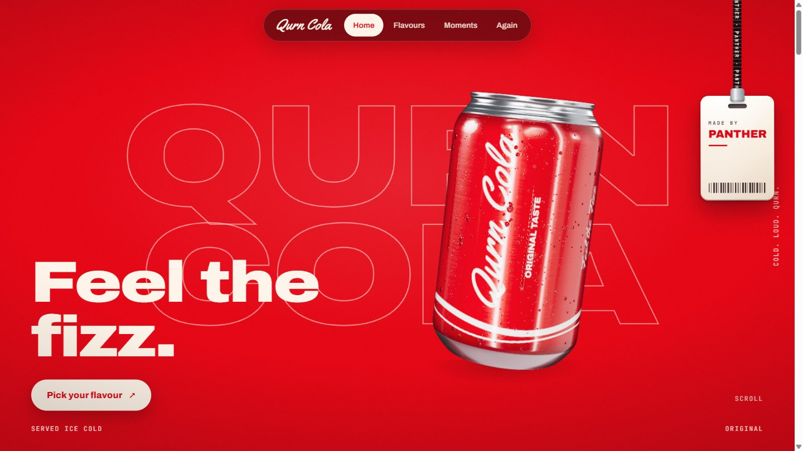

<div align="center">

```
  ██████  ██    ██ ██████  ███    ██
 ██    ██ ██    ██ ██   ██ ████   ██
 ██    ██ ██    ██ ██████  ██ ██  ██
 ██ ▄▄ ██ ██    ██ ██   ██ ██  ██ ██
  ██████   ██████  ██   ██ ██   ████
     ▀▀
```

**A team of expert advisers for your coding agent: they research, design, test, secure and plan your project, and `/qurn` runs them together.**

[](LICENSE)
[](skills/)
[](#commands)
[](#install)

</div>

<br>

<!-- Demo GIF goes here, before any text: a 5-10 second recording of /qurn running.   -->

```bash
git clone https://github.com/PantherHale/qurn-skills && cd qurn-skills && ./install.sh claude   # Windows: ./install.ps1 -Agent claude
```

Ten commands turn any coding agent into a small studio: a fact-checker, a web designer, a test board, an
architect, a coder, a security reviewer, a delegator, a team lead that runs all of them, a weekly researcher that
keeps the rest current, and a plain-language status report. Each one is built from cited sources — not improvised
prompts — and ships as a portable `SKILL.md` plus reference files, so it works the same way in Claude Code,
Codex, or a plain system prompt to a local model.

<p align="center">
  <a href="#commands">Commands</a> ·
  <a href="#install">Install</a> ·
  <a href="#usage">Usage</a> ·
  <a href="#how-its-built">How it's built</a> ·
  <a href="#showcase">Showcase</a> ·
  <a href="#license">License</a>
</p>

<br>

## Commands

| Command | Specialist | What it does |
|---|---|---|
| `/research` | Research | Checks a claim, a library fact, or a legal/regulatory detail against real sources before anyone acts on it. Never invents a fact — anything it can't trace to an actual source is labelled "to verify," not stated as true. |
| `/web` | Web designer | Takes stock of a site or app's UI, picks a concrete visual direction (minimalism, brutalism, bento, glassmorphism, neumorphism, and more), and hands back numbered build orders instead of a vague opinion. |
| `/tester` | Test board | Builds the full test plan for a project — unit, integration, end-to-end, accessibility, performance, environment, error paths — convenes a board of tester personas, and blocks a "done" claim that has no evidence behind it. |
| `/architect` | Architect | Splits a goal into phases and tasks, sets module boundaries and structure, and catches drift from the plan midway through a build. For a project that runs its own autonomous agents, also advises on the merge-gate and worktree-isolation pattern. |
| `/coder` | Coder | Advises on language, database, and project structure; reviews an implementation for performance and structure; tells a coding agent how to spend fewer tokens doing the same work. |
| `/security` | Security | Reviews auth, payments, uploads, secrets, dependencies, desktop IPC, and AI features before launch, plus the legal product checks (unsubscribe, consent, age gates, privacy rights) that get skipped under deadline pressure. |
| `/delegator` | Delegator | Breaks a goal too big for one agent into parallel and sequential work, deciding how many workers it needs and writing each one a self-contained prompt. |
| `/qurn` | Team lead | Reads a request, decides which of the above specialists actually apply, consults each one in turn, does the building or fixing their advice calls for, and reports one rolled-up verdict. Use this one when you're not sure which specialist fits, or the job spans more than one. |
| `/evolve` | Researcher | Spends a pass researching the last 7 days in security, design, architecture, coding, testing, and AI-agent tooling, and writes dated, sourced notes that every other specialist reads from afterward. |
| `/status` | — (utility) | Not a specialist: reads the ledger a `qurn` run leaves behind (or, failing that, git state) and reports what's done, what's blocked, and what's next, in plain language — no verdict, no building, no opinion. |

`web`, `tester`, `architect`, `coder`, `security`, `delegator`, and `qurn`'s own rolled-up verdict all reply with
`VERDICT: pass`, `fix`, or `redo`, plus the evidence behind it — file, line, a measurement, test output — and
concrete next steps. `research` replies with its own scale instead (`confirmed`, `mixed`, or `unconfirmed`), since
it's checking a claim, not judging a build. `evolve` and `status` don't use verdict grammar at all: `evolve` just
writes dated, sourced notes, and `status` only reports what it found. `qurn` is the only one that writes code; the
rest hand back advice or a verdict for whatever agent or developer is driving.

<br>

## Install

Clone the repo, then run the installer for your agent. It copies the `skills/` (or equivalent) folder to wherever
that agent looks for skills — project-local or system-wide, your choice.

```sh
git clone https://github.com/PantherHale/qurn-skills.git
cd qurn-skills

# user-wide install (available in every project)
./install.sh claude            # Claude Code
./install.sh codex             # Codex
./install.sh gemini            # Gemini CLI

# project-only install
./install.sh claude --project
```

On Windows:

```powershell
git clone https://github.com/PantherHale/qurn-skills.git
cd qurn-skills
./install.ps1 -Agent claude
```

No installer for your tool? Grab what you need directly:

| Your setup | What to copy |
|---|---|
| Any Agent-Skills-compatible CLI | `skills/<name>/` into wherever it reads skills from |
| Cursor | `adapters/cursor/*.mdc` into `.cursor/rules/` |
| Windsurf | `adapters/windsurf/*.md` into `.windsurf/rules/` |
| GitHub Copilot | `adapters/copilot/*.instructions.md` into `.github/instructions/`, plus `AGENTS.md` at the repo root |
| Cline | `adapters/cline/*.md` into `.clinerules/` |
| Aider | point `.aider.conf.yml` at `AGENTS.md` (see `adapters/aider/`) |
| Claude Code subagents | `adapters/claude-agents/*.md` into `.claude/agents/` |
| Any MCP client (Claude Desktop, VS Code, Zed, Continue, …) | point it at `mcp/server.mjs` — zero dependencies, runs with plain `node` |
| A model with no skill loader at all (Ollama, DeepSeek, a bare API call) | paste `flatten/<name>.prompt.md` in as the system prompt |

Full agent-by-agent path table in [INSTALL.md](INSTALL.md).

<br>

## Usage

```
/qurn build a pricing page and make sure it's ready to ship
/security review this app before launch
/architect plan the migration to the new auth system
/web redesign the dashboard, something bolder than what we have
/status what's left before this ships
```

Prefix any command with `start`, `middle`, or `end` to force which checkpoint it reviews from; left off, the
specialist infers it from the state of the project.

<br>

## How it's built

```
skills/<name>/SKILL.md       the specialist: YAML front matter + instructions
skills/<name>/references/    the longer material the instructions point into
flatten/<name>.prompt.md     the whole specialist flattened into one file
commands/codex/, gemini/     native slash-command files for those two CLIs
adapters/                    Cursor, Windsurf, Copilot, Cline, Aider, Claude subagents
mcp/server.mjs               one dependency-free MCP server exposing the six frozen specialists
research/                    the cited sources each specialist's advice is built from (not the /research skill --
                              that one lives in skills/research/, same as any other command)
```

Most of the above is generated from one source of truth — the specialists running day to day inside a private
production app — so the published skills and the live versions mostly don't drift apart. The rest (`research`,
`evolve`, `qurn`, `status`, and some reference material such as the agent-infra and style-recipe additions) is
maintained directly in this repo, since it falls outside that app's own six-specialist export. Forking this to
change a specialist's behavior means editing its `SKILL.md` and references directly; there's no separate build
step required on a fork.

<br>

## Showcase

<a href="https://qurncola.pages.dev"></a>

**Qurn Cola**: a demo website to showcase the skills of qurn.
**[Live site](https://qurncola.pages.dev)** · **[Source](https://github.com/PantherHale/qurn-cola)**

```
/qurn make me a scroll-animated cola landing page, research, plan and build it, fully finished
```

| Specialist | What it did on this build |
|---|---|
| `architect` | 12-part plan with phases, estimates, risks and ADRs before a line of code |
| `web` | Picked the commercial-style direction and wrote the build orders: a live 3D can that travels between scenes, colour-drenched flavour act, share-a-name label printing |
| `coder` | Profiled fast scrolling and cut the worst frame from 217 ms to 18 ms (steady 60 fps) |
| `tester` | Checked every page in Chrome at desktop and phone sizes, with reduced motion and no console errors |
| independent reviewer | Three blind review rounds pushed the can from "looks CG" to a photo-style render |

Four pages, a WebGL can with real 330 ml proportions, studio HDRI lighting, condensation and a stamped lid and base,
plus a draggable "Made By Panther" lanyard. Static files, no build step.

<br>

## License

[MIT](LICENSE)

<div align="center">

<sub>Built for Claude Code, Codex, Gemini CLI, Cursor, Windsurf, Copilot, Cline, Aider, and MCP.</sub>

</div>
